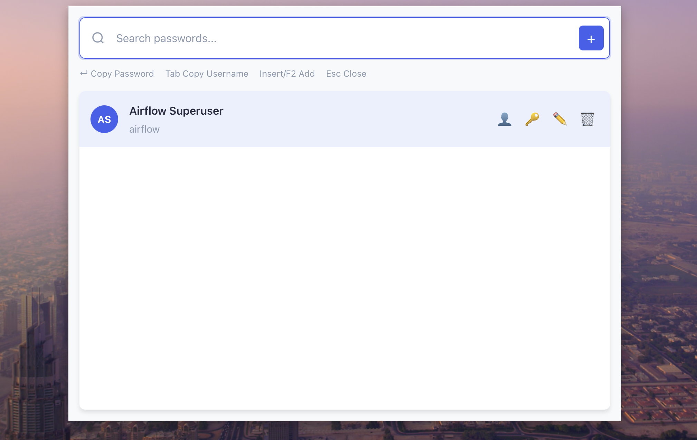
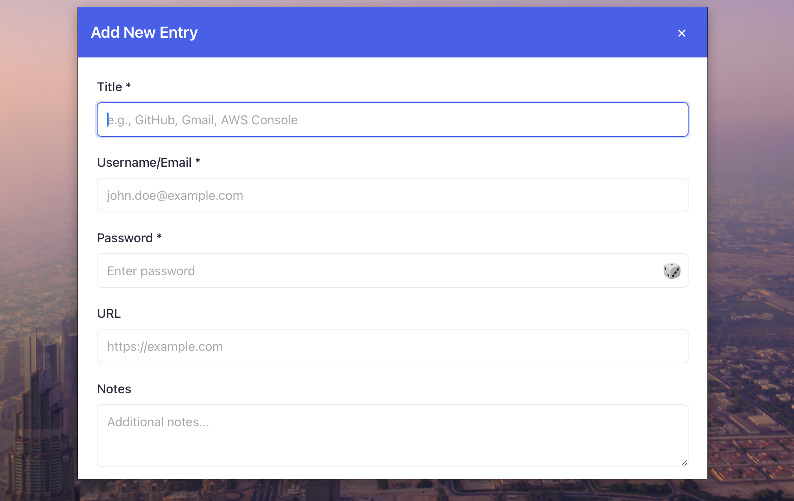

# Cocoon

### *Your Passwords, Safely Enfolded.*

-----

Cocoon is a secure, cross-platform password manager built with Rust, designed for speed and convenience. Inspired by the natural world's most protective enclosures, Cocoon keeps your digital credentials safely enfolded, accessible whenever you need them.

## Why Cocoon?

In today's digital landscape, strong, unique passwords are your first line of defense. But remembering them all is impossible, and typing them out is tedious. Cocoon offers a solution that balances ironclad security with ease of use, all built with the performance and safety guarantees of **Rust**.

-----

## Current Status

🎉 **v1.1 Available**: Cocoon now features **enterprise-grade security** with **AES-256 encryption**, **master password authentication**, and **Spotlight-like interface** for macOS users.

**What's Working:**
- ✅ **AES-256 GCM encryption** with Argon2 key derivation for military-grade security
- ✅ **Master password authentication** - your vault is now truly secure
- ✅ **Spotlight-like interface** on macOS with enhanced focus management
- ✅ **Advanced auto-fill capabilities** with one-click login automation
- ✅ **Smart typing simulation** that preserves focus between applications
- ✅ Cross-platform compatibility (Windows & macOS)
- ✅ **Global hotkey for quick access** `Ctrl+P` (like Spotlight)
- ✅ **System tray integration** with click-to-show functionality
- ✅ **Auto-hide on focus loss** for enhanced security
- ✅ **Clipboard integration** for one-click password/username copying
- ✅ **Auto-start on system boot** capability
- ✅ Fast search and filtering across all password entries
- ✅ Full CRUD operations (Create, Read, Update, Delete) for password entries
- ✅ **Password strength analysis** with visual indicators
- ✅ **Secure password generator** with customizable options
- ✅ **Encrypted vault export** for secure backups

**Coming Soon:**
- 🔄 Linux support with X11 integration
- 🔄 Browser extensions for seamless web integration
- 🔄 Import functionality from other password managers
- 🔄 Two-factor authentication support
- 🔄 Secure notes and document storage

-----

## Key Features

### 🔒 Security Features
- **AES-256 GCM Encryption**: Military-grade encryption for data at rest
- **Argon2 Key Derivation**: Industry-standard password hashing with salt
- **Master Password Protection**: Zero-knowledge architecture - only you can decrypt your data
- **Memory-Safe Implementation**: Built with Rust to prevent security vulnerabilities
- **Local-Only Storage**: Your passwords never leave your device
- **Auto-Hide Protection**: Window automatically hides when focus is lost
- **Secure Memory Handling**: Sensitive data cleared from memory after use

### ⚡ Spotlight-Like Experience (macOS)
- **Global Hotkey Access**: Quick access via `Ctrl+P` (just like Spotlight)
- **Floating Panel**: Appears above all applications, including fullscreen
- **Smart Focus Management**: Remembers and restores your previous application
- **Auto-Hide Behavior**: Disappears when you click elsewhere or press Escape
- **Instant Search**: Real-time filtering as you type
- **One-Click Actions**: Copy or auto-fill credentials instantly

### 🚀 Advanced Auto-Fill
- **Smart Typing Simulation**: Types credentials directly into any application
- **Focus Preservation**: Maintains application focus during auto-fill
- **One-Click Login**: Auto-fill username, password, and press Enter
- **Tab Navigation**: Automatically moves between username and password fields
- **Cross-Platform Support**: Works consistently across Windows and macOS

### 💪 Productivity Features
- **Password Generator**: Create strong, unique passwords with customizable rules
- **Password Strength Analysis**: Visual indicators for password security
- **Smart Search**: Real-time filtering across titles, usernames, and URLs
- **Secure Export**: Encrypted backup functionality with custom passwords
- **Fast & Lightweight**: Built with Rust and Tauri for optimal performance
- **Open Source**: Fully transparent codebase for security auditing

### 🎯 Planned Features
- **Browser Extensions**: Direct integration with Chrome, Firefox, Safari
- **Import Tools**: Migrate from 1Password, LastPass, Bitwarden, etc.
- **Linux Support**: Complete cross-platform coverage with X11/Wayland
- **Two-Factor Authentication**: TOTP support for additional security
- **Secure Notes**: Store sensitive documents and information
- **Team Sharing**: Secure password sharing for organizations

-----

## Getting Started

### Prerequisites
- Windows 10+ or macOS 10.14+
- No additional dependencies required

### Installation

#### Option 1: Download Release (Recommended)
1. Visit our [Releases page](https://github.com/pesnik/cocoon/releases)
2. Download the appropriate binary for your platform:
   - `cocoon-windows.exe` for Windows
   - `cocoon-macos` for macOS
3. Run the application and set up your master password

#### Option 2: Build from Source
```bash
# Clone the repository
git clone https://github.com/pesnik/cocoon.git
cd cocoon

# Build for your platform
cargo build --release

# Run the application
# Windows: target/release/cocoon.exe
# macOS: target/release/cocoon
```

### First Time Setup
1. **Launch Cocoon** - The app will start minimized to your system tray
2. **Create Master Password**: Set up a strong master password (minimum 8 characters)
3. **Access via Hotkey**: Press `Ctrl+P` for Spotlight-like quick access
4. **Add Your First Password**: Click "Add New Entry" to start building your encrypted vault
5. **Test Auto-Fill**: Try the auto-fill feature on any login form

### Daily Usage
**Opening Cocoon:**
- **Global Hotkey**: `Ctrl+P` (works from any application, like Spotlight)
- **System Tray**: Click the Cocoon icon in your system tray
- **Auto-Start**: Cocoon launches automatically when your system starts

**Using Auto-Fill:**
1. **Navigate to Login Form**: Open any application or website with a login form
2. **Activate Cocoon**: Press `Ctrl+P` to open the Spotlight-like interface
3. **Search**: Start typing to filter your password entries
4. **Auto-Fill Options**:
   - **Copy Password**: Click the copy button to copy to clipboard
   - **Type Username**: Automatically types username into the focused field
   - **Type Password**: Automatically types password into the focused field  
   - **Auto-Fill & Login**: Types both credentials and presses Enter to login
5. **Cocoon Hides**: Interface automatically disappears, returning focus to your application

**Managing Passwords:**
- **Add New Entry**: Fill in website, username, password, and optional notes
- **Password Generator**: Create strong passwords with customizable options
- **Search & Filter**: Type to instantly filter entries by title, username, or URL
- **Edit/Delete**: Modify or remove entries as needed
- **Export Vault**: Create encrypted backups of your password vault

-----

## Screenshots

Get a glimpse of Cocoon's intuitive, Spotlight-inspired interface:

| **Spotlight-Like Interface** | **Auto-Fill in Action** | **Password Generator** |
|-------------------|-------------------|-------------------|
|  |  |  |
| Quick access like macOS Spotlight | Seamless auto-fill across applications | Generate strong, secure passwords |

| **Master Password Setup** | **Search & Filter** | **Entry Management** |
|-------------------|-------------------|-------------------|
|  |  |  |
| Secure setup with encryption | Lightning-fast search capabilities | Simple, intuitive entry management |

*Screenshots reflect the current v1.1 version with enhanced security and Spotlight-like interface.*

-----

## Development

### Building from Source

Ensure you have Rust installed (visit [rustup.rs](https://rustup.rs/) for installation instructions).

```bash
# Clone and build
git clone https://github.com/pesnik/cocoon.git
cd cocoon
cargo build --release

# Run tests
cargo test

# Run in development mode
cargo run
```

### Dependencies
Cocoon uses several key Rust crates for security and functionality:
- **aes-gcm**: AES-256 GCM encryption
- **argon2**: Password hashing and key derivation
- **tauri**: Cross-platform app framework
- **serde**: Data serialization
- **chrono**: Date/time handling
- **base64**: Encoding for encrypted data

### Platform-Specific Notes

**Windows:**
- Builds require Windows 10 SDK
- Uses Windows API for input simulation
- Executable will be in `target/release/cocoon.exe`

**macOS:**
- Requires Xcode command line tools
- Uses Core Graphics for advanced input simulation
- Implements Spotlight-like NSPanel behavior
- Binary will be in `target/release/cocoon`
- May need to allow in Security & Privacy settings

**Linux (Planned):**
- Will use X11/Wayland for input simulation
- Planned support for GNOME and KDE environments

-----

## Roadmap

### v1.1 (Current Release) ✅
- [x] **AES-256 GCM encryption** with master password authentication
- [x] **Spotlight-like interface** with enhanced focus management (macOS)
- [x] **Advanced auto-fill capabilities** with typing simulation
- [x] **Password strength analysis** with visual indicators
- [x] **Secure password generator** with customizable options
- [x] **Encrypted vault export** for secure backups
- [x] **Smart focus preservation** during auto-fill operations
- [x] **One-click login automation** with Enter key simulation

### v1.2 (Security & Cross-Platform)
- [ ] **Linux support** - Complete X11/Wayland integration
- [ ] **Two-factor authentication** - TOTP support for additional security
- [ ] **Secure clipboard management** - Auto-clear clipboard after copying
- [ ] **Biometric authentication** - Touch ID/Face ID support where available
- [ ] **Hardware security key support** - YubiKey and FIDO2 integration

### v1.3 (Productivity & Integration)
- [ ] **Browser extensions** - Chrome, Firefox, Safari integration
- [ ] **Import functionality** - Migrate from 1Password, LastPass, Bitwarden
- [ ] **Categories and tags** - Better organization for large password collections
- [ ] **Password history** - Track password changes over time
- [ ] **Secure notes** - Store sensitive documents and information
- [ ] **Automatic password changing** - Update passwords on supported sites

### v2.0 (Team & Enterprise)
- [ ] **Team sharing** - Secure password sharing for organizations
- [ ] **Role-based access control** - Admin controls for team accounts
- [ ] **Audit logging** - Track access and changes for compliance
- [ ] **SSO integration** - Support for enterprise identity providers
- [ ] **Advanced reporting** - Security insights and recommendations

-----

## Security

**Current Security Features:**
- **AES-256 GCM Encryption**: Military-grade encryption for all stored data
- **Argon2 Key Derivation**: Industry-standard password hashing with configurable iterations
- **Zero-Knowledge Architecture**: Only you can decrypt your data - not even we can access it
- **Local-Only Storage**: Your passwords never leave your device
- **Memory-Safe Implementation**: Built with Rust to prevent common security vulnerabilities
- **Secure Memory Handling**: Sensitive data is cleared from memory after use
- **Auto-Hide Protection**: Window automatically hides when focus is lost
- **Master Password Protection**: Strong authentication required to access your vault

**Encryption Details:**
- **Algorithm**: AES-256 in GCM mode with authenticated encryption
- **Key Derivation**: Argon2id with random salt and 100,000 iterations
- **Data Format**: Base64-encoded encrypted data with separate nonce storage
- **File Format**: Encrypted JSON with version control for future upgrades

**Security Best Practices:**
- Choose a strong, unique master password (minimum 8 characters)
- Enable auto-start to ensure Cocoon is always available when needed
- Regularly export encrypted backups to secure locations
- Keep Cocoon updated to receive the latest security improvements
- Use the password generator for all new accounts

**Planned Security Enhancements:**
- **Biometric authentication** - Touch ID, Face ID, Windows Hello support
- **Hardware security keys** - YubiKey and FIDO2 integration
- **Two-factor authentication** - TOTP support for additional security
- **Key rotation** - Automatic master key rotation with configurable intervals
- **Secure audit logs** - Encrypted logging of access patterns and changes

Found a security issue? Please report it privately to [security@cocoon-pm.com](mailto:security@cocoon-pm.com).

-----

## License

Cocoon is distributed under the [MIT License](LICENSE). See the LICENSE file for full details.

-----

## Community

Join the conversation and stay updated:

- **GitHub**: [pesnik/cocoon](https://github.com/pesnik/cocoon)
- **Issues**: [Report bugs or request features](https://github.com/pesnik/cocoon/issues)
- **Discussions**: [Community discussions](https://github.com/pesnik/cocoon/discussions)
- **Security**: [security@cocoon-pm.com](mailto:security@cocoon-pm.com)

-----

**Cocoon: Your Digital World, Securely Enfolded.**

*Built with ❤️ and Rust for security, performance, and peace of mind.*

---

## Changelog

### v1.1.0 - "Spotlight Security" (Current)
- ✨ **NEW**: AES-256 GCM encryption with master password authentication
- ✨ **NEW**: Spotlight-like interface on macOS with enhanced focus management  
- ✨ **NEW**: Advanced auto-fill with typing simulation and one-click login
- ✨ **NEW**: Password strength analysis and secure password generator
- ✨ **NEW**: Encrypted vault export for secure backups
- 🔧 **CHANGED**: Global hotkey updated to `Ctrl+P` for Spotlight-like experience
- 🔧 **IMPROVED**: Enhanced security with zero-knowledge architecture
- 🔧 **IMPROVED**: Better cross-platform input simulation
- 🐛 **FIXED**: Focus management issues during auto-fill operations

### v1.0.0 - "MVP Release"
- 🎉 Initial release with basic password management
- ✅ Cross-platform support (Windows & macOS)
- ✅ System tray integration and global hotkey access
- ✅ Local JSON storage (unencrypted)
- ✅ Basic CRUD operations for password entries
